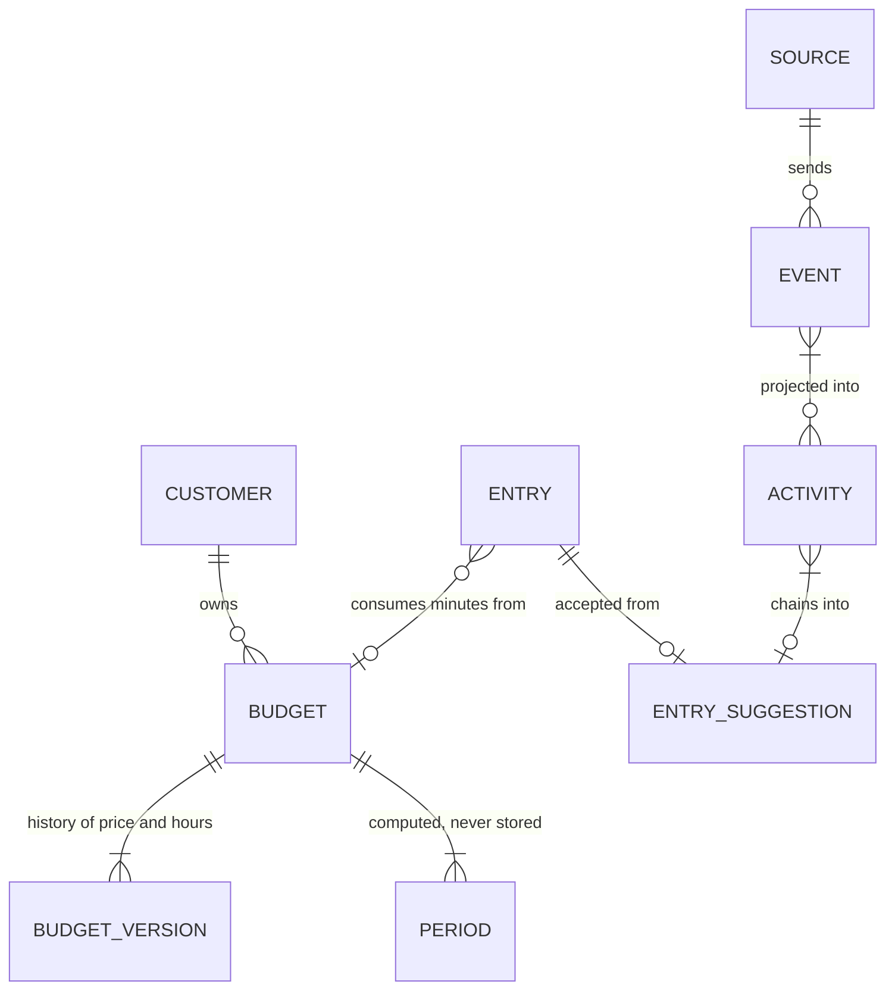

## Timatic API

Timatic registers the work of engineers: who worked, for which customer, on which ticket, from when to when, and on what account. The hours feed invoicing and consume customer budgets.

Everything users do day to day goes through the JSON:API, consumed by the frontend and the browser extension. The admin panel is for setup only: integrations, suggestion sources, roles. A user should rarely need it.

## Concepts

```
Customer ─▶ Budget ─▶ Version ─▶ Period ─▶ Entry
Source ─▶ Event ─▶ Activity ─▶ Suggestion ─▶ Entry
```



**Budgets** are pots of hours a customer bought. A budget's price and hours live in versions valid from a date, so a change never rewrites the past. Periods are the renewal windows and are derived on demand from the budget's start, end and renewal frequency. An entry consumes its minutes spent from the period it starts in; an entry without a budget is internal or paid per hour.

**Suggestions** exist because engineers forget to book hours. Integrations send events (commits, issue transitions, meetings, browser focus) and every event rebuilds the user's day: events become activities, the strongest evidence claiming each minute first, and activities of one customer chain into suggestions the engineer accepts or dismisses. Accepting creates the entry.

The full rules, each pinned by a test, live in [`docs/`](./docs/README.md): start with the [glossary](./docs/GLOSSARY.md), then [budgets](./docs/budgets/overview.md), [entries](./docs/entries/overview.md) and [suggestions](./docs/suggestions/overview.md).

## Setup local development environment

```bash
cp .env.example .env
composer install
npm install
npm run build
php artisan key:generate
php artisan timatic:install
herd link api.app.timatic --secure
```

`npm run build` compiles the Filament admin theme and the stylesheet for the integration consent pages. Deployments must run it too, otherwise those pages render unstyled.

`timatic:install` runs migrations, creates the first admin user, and optionally generates an API token and seeds dummy data.

### Authentication

A deployment runs exactly one identity provider. Set `SOCIALITE_DRIVER` to `azure`, `google` or
`auth0` and fill that provider's credentials in `.env`; `auth/redirect` answers 503 until it can, so a
misconfigured deployment says so itself rather than failing inside the provider.

Browser callers authenticate with a bearer token, not the session. `ApiClientSeeder` registers who
may ask for one, which redirect uris their codes may travel to and how long their tokens live. Re-run
it after changing `APP_FRONTEND_URL` or `EXTENSION_IDS`:

| Client | Redirect uris from | Lifetime |
|---|---|---|
| `web` | `APP_FRONTEND_URL` + `/auth/callback` | 30 days |
| `chrome-extension` | `EXTENSION_IDS` | 90 days |

Integration packages register clients of their own. A registered `http://127.0.0.1` or
`http://[::1]` redirect uri matches any port (RFC 8252 §7.3), so a command line client can listen on
whichever port is free. A client with `sliding_expiration` gets its token's expiry pushed forward on
every use, so the token only lapses after its lifetime without use.

The web session remains in use by the Filament admin panel, the integration consent pages and the
`oauth/authorize` consent screen. Keep `SESSION_SAME_SITE=lax` and `SESSION_SECURE_COOKIE=true`:
`lax` is what lets the cookie travel on the browser's top level navigations to `oauth/authorize`
and `auth/logout`.

### Dummy data

To (re)seed dummy data at any time:

```bash
php artisan db:seed --class=DummySeeder
```

### API documentation

`/docs` serves the committed `public/api.json`, which the `export-api-docs` workflow regenerates with [Scramble Pro](https://scramble.dedoc.co/pro) on pushes to `main`. Pro is not in `composer.json`, so locally `/docs` shows the free Scramble output, without filter, include and pagination parameters.

To regenerate `public/api.json` locally, set the license credentials once and run the export. It installs Pro temporarily and restores `composer.json`/`composer.lock` afterwards:

```bash
composer config -g http-basic.satis.dedoc.co <username> <password>
composer docs:api
```

## Commands

### Rebundle entry suggestions

Rebuilds the activities and open suggestions of every user-day in the range from its
events, using the current rules (see [the suggestion lifecycle](./docs/suggestions/lifecycle.md)):

```bash
php artisan timatic:rebundle-suggestions [--user=1] [--from=2026-06-01] [--to=2026-06-30]
```

Pause queue workers before running this against live data, so queued rebuilds of the
same user-days cannot interleave with the rebundle.

## License

Copyright (c) 2025 Timatic.

You may use this software internally within your organization for any purpose. Selling, sublicensing, or providing the software to third parties for commercial gain is prohibited. See [LICENSE.txt](./LICENSE.txt) for full terms.
