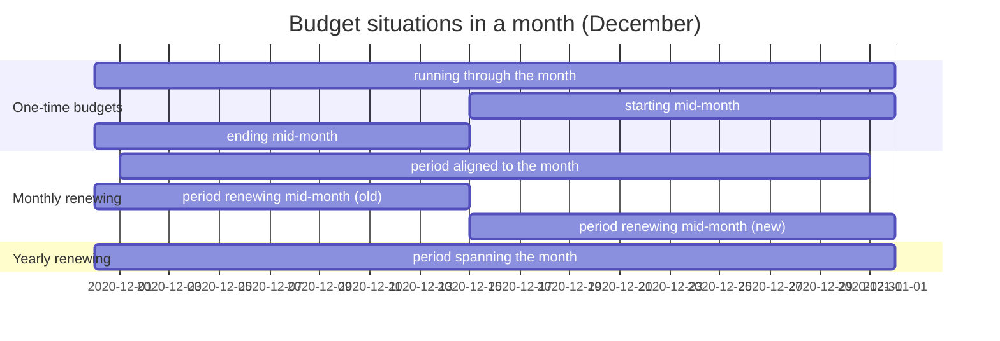

# Budget usage

Read this when you change the monthly usage report, the budget mutation export or anything that reports used, expired or renewed credit per month.

## Goal

Finance needs, per budget and per month, how the credit moved: what the month started with, what was used inside the budget, what was used beyond it, what expired when a period ended, what came in when a period renewed, and what was left. The report is computed from the periods observed at the first and the last day of the month, so **it is reproducible for any past month** without storing anything.

A mutation holds six amounts in credit (money):

| amount | meaning |
| --- | --- |
| start balance | remaining credit of the period running on the first day of the month, seen at that day |
| used credit | credit consumed while the balance was still positive |
| used out of budget | credit consumed after the balance reached zero |
| expired credit | what was left in a period that ended during the month |
| renewed credit | the total price of the active version, when a new period started during the month |
| end balance | remaining credit of the period running on the last day of the month, seen at that day |

While a budget stays within its credit, `start balance − used credit − expired credit + renewed credit = end balance`. Overrun is reported separately as used out of budget and never pushes the end balance below zero.

The situations the report covers in one month:

## Rules

- **A budget is in the report for a month when it is active in it**: it started before the month ended, ends after the month started, and is either not archived or was archived after the month started. Test: `budget usage service should ignore archived budgets`.
- **A period that ends during the month expires its remainder.** The remaining credit at the month's end becomes expired credit and the end balance is zero. The same happens when the budget ends or is archived during the month. Tests: `budget usage service has expire credit for budgets with ended at`, `budget usage service has expire credit for archived budgets`.
- **A renewal during the month counts both periods.** The old period contributes its usage and expiry; the new period adds the active version's total price as renewed credit and its own usage up to the month's end. Tests: `budget that renews during the month has renewed credit`, `correct values are used from start and end periods from budget that renews during the month`.
- **Usage splits at zero.** When a period goes from positive to negative within the month, the positive part is used credit and the negative part is used out of budget. When it starts negative, everything is out of budget. Two periods depleted in the same month add up. Tests: `with negative start balance`, `depletion of two periods in the same month add up`.
- **Corrections reverse usage in the bucket they came from.** A correction on an overrun budget reduces used out of budget, a partial correction reduces only the out-of-budget part, and a correction on a budget still in credit shows as negative used credit. Tests: `budget with negative balance will not report correction entry as used budget`, `budget with negative balance will not report partial correction entry as used budget`, `a correction entry on a new budget should show as used credit`.
- **A budget starting mid-month starts from its own first period.** When no period runs on the first of the month, the period at the budget's start supplies the start balance.

## Where in the code

- `app/Services/BudgetUsageService.php`, `app/DataTransferObjects/BudgetMutation.php`, `app/Exports/MonthlyBudgetsExport.php`, `app/Queries/BudgetsRenewingInMonth.php`
- Tests: `tests/Feature/BudgetUsage/RecurringBudgetTest.php`, `tests/Feature/BudgetUsage/OutOfBudgetTest.php`, `tests/Feature/BudgetUsage/NegativeUsageTest.php`, `tests/Feature/BudgetUsage/ArchivedBudgetsTest.php`, `tests/Feature/Exports/BudgetMutationsExportTest.php`
