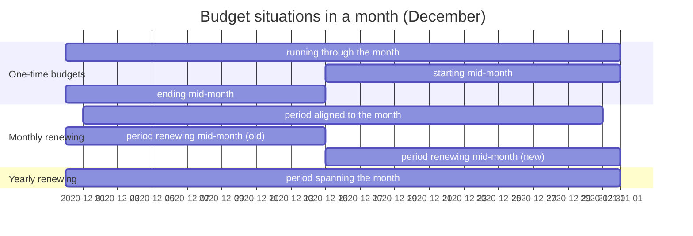

# Budget usage

Read this when you change the monthly usage report, the budget mutation export or anything that reports used, expired or renewed credit per month.

## Goal

Finance needs, per budget and per month, how the credit moved: what the month started with, what was used inside the budget, what was used beyond it, what expired when a period ended, what came in when a period renewed, and what was left. The report is computed from the periods observed at the first and the last day of the month, so **it is reproducible for any past month** without storing anything.

A mutation holds six amounts in credit (money):

| amount | meaning |
| --- | --- |
| start balance | remaining credit of the period running on the first day of the month, seen at that day |
| used credit | credit consumed while the balance was still positive |
| used out of budget | credit consumed after the balance reached zero |
| expired credit | what was left in a period that ended during the month |
| renewed credit | the total price of the active version, when a new period started during the month |
| end balance | remaining credit of the period running on the last day of the month, seen at that day |

While a budget stays within its credit, `start balance − used credit − expired credit + renewed credit = end balance`. Overrun is reported separately as used out of budget and never pushes the end balance below zero.

The situations the report covers in one month:

## Rules

- **Whatever a period has left when it ends is expired, and the end balance is zero.** The same when the budget ends or is archived during the month. Unused hours never carry over. Tests: `budget usage service has expire credit for budgets with ended at`, `budget usage service has expire credit for archived budgets`.
- **A renewal during the month counts both periods**: the old one's usage and expiry, the new one's renewed credit and usage up to the month's end. Tests: `budget that renews during the month has renewed credit`, `correct values are used from start and end periods from budget that renews during the month`.
- **Usage splits at zero.** The part of a period's consumption above zero is used credit, the part below is used out of budget, also when the crossing happens within the month. Tests: `with negative start balance`, `depletion of two periods in the same month add up`.
- **Corrections show as negative usage in the bucket they reverse.** A correction on an overrun budget reduces used out of budget; on a budget still in credit it shows as negative used credit. That is deliberate: the report must sum to the entries. Tests: `budget with negative balance will not report correction entry as used budget`, `budget with negative balance will not report partial correction entry as used budget`, `a correction entry on a new budget should show as used credit`.

## Where in the code

- `app/Services/BudgetUsageService.php`, `app/DataTransferObjects/BudgetMutation.php`, `app/Exports/MonthlyBudgetsExport.php`, `app/Queries/BudgetsRenewingInMonth.php`
- Tests: `tests/Feature/BudgetUsage/RecurringBudgetTest.php`, `tests/Feature/BudgetUsage/OutOfBudgetTest.php`, `tests/Feature/BudgetUsage/NegativeUsageTest.php`, `tests/Feature/BudgetUsage/ArchivedBudgetsTest.php`, `tests/Feature/Exports/BudgetMutationsExportTest.php`
